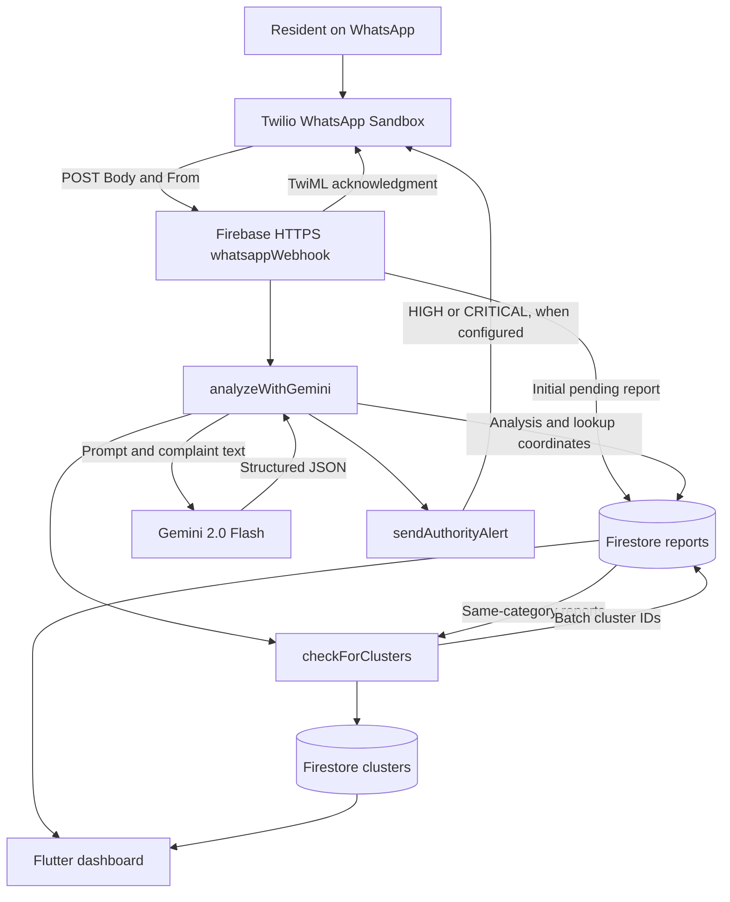

# LaporKita AI: implemented prototype architecture

This document describes the checked-in implementation in `functions/index.js`, rather than a claim that the hosted service is currently running. The project is an AI-assisted processing pipeline, not an autonomous tool-using agent.

## Responsibilities and data flow

1. `whatsappWebhook` reads `Body` and `From`, ignores empty status callbacks, and creates a report with message, sender, pending status, analysis placeholders and server timestamp.
2. It sends a TwiML acknowledgment before analysis finishes. Reply language selection uses a Malay-word heuristic; these acknowledgment messages are templates, not Gemini-generated replies.
3. `analyzeWithGemini` prompts Gemini for urgency, category, sentiment, keywords, location, summary and suggested action, strips Markdown fences and parses JSON.
4. The webhook updates the report with analysis, `analyzed_at`, `ai_processed`, status and coordinates. Coordinates come from a static location-name lookup, not device GPS or a geocoding API.
5. `sendAuthorityAlert` attempts a Twilio message for HIGH/CRITICAL reports when `AUTHORITY_WHATSAPP` is configured.
6. `checkForClusters` queries reports in the same category and uses keyword overlap divided by the union of keywords, with a 0.15 threshold. Two reports are sufficient to form a group. It creates or updates a cluster and batch-writes report cluster IDs. The active implementation uses template titles/summaries, not an autonomous agent or a trained clustering model.
7. The Flutter dashboard consumes Firestore reports and clusters for display. `firebase.json` points hosting at `laporkita_dashboard/build/web`.

The exported support endpoints `analyzeReport`, `analyzeAllPending` and `runClustering` support reprocessing and grouping. `functions/clustering.js` contains an alternative implementation; the webhook calls the local function in `functions/index.js`, so its behavior is authoritative for this diagram.

## Design choices

- Node.js cloud functions connect webhook intake, model API calls and Firestore storage without a separate application server.
- Firestore separates individual reports from grouped issues and supports dashboard snapshot updates.
- Structured JSON makes model outputs usable by downstream UI and alert logic. JSON parsing alone does not validate every field or ensure factual correctness.
- Keyword grouping is inspectable and inexpensive, but lacks semantic embeddings and geographic-distance matching. Current category queries do not apply a time window.
- Immediate acknowledgment reduces user waiting, but does not prove processing succeeded.

## Error handling and limitations

Gemini requests are attempted up to three times, with a one-second delay between failures. Exhaustion returns UNKNOWN urgency and a manual-review suggestion. The webhook currently marks even fallback analysis as processed; processing completion must not be confused with successful classification. Alert errors are logged and missing authority configuration skips alerts. Background errors are logged.

Analysis runs in a promise chain after the HTTP acknowledgment. It is not a durable queue: post-response execution, retries, deduplication, concurrency and recovery require further engineering. No production reliability or throughput guarantee is established by this code.

The checked-in Firestore rules permit client access only before 20 March 2026; this is an expired prototype configuration and does not establish the live deployed rules. The HTTP handlers do not demonstrate Twilio signature verification or full endpoint authorization. Production use requires appropriate authentication, access rules, input validation, privacy controls and durable processing. This documentation does not deploy or change those controls.

## Evaluation

See [evaluation methodology](metrics/EVALUATION.md) for the 94 saved test records, exact-match and partial-credit results, and reproducibility limits. No fresh cloud deployment, live API test or field-performance measurement was performed for this documentation update.
